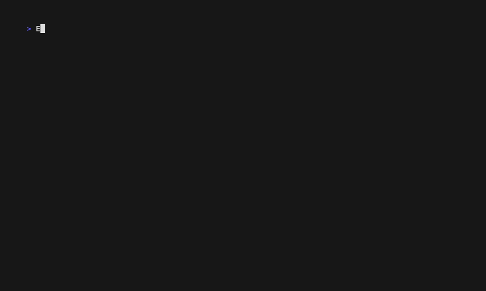
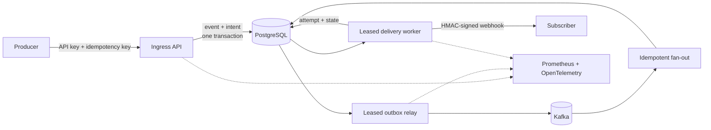

# EventMesh

**A multi-tenant event ingestion and signed-webhook delivery platform that makes
failure behavior visible and testable.**

EventMesh accepts idempotent events, commits each event and its Kafka publication
intent in one PostgreSQL transaction, then delivers matching webhooks with
HMAC signatures, retry history, dead-letter state, and replay. It is a Java 21
modular monolith packaged for Docker Compose and Kubernetes without a cloud SDK.



The demo above injects two real subscriber failures. One durable delivery
recovers from `503 → 503 → 204`; every request has a valid signature and the
same delivery ID.

## What this project proves

- **Concurrency correctness:** tenant-scoped idempotency is enforced by a
  PostgreSQL uniqueness constraint and tested with simultaneous requests.
- **Failure-aware design:** a transactional outbox closes the database/broker
  dual-write gap; expiring leases make relay and worker crashes recoverable.
- **Honest delivery semantics:** webhook delivery is at least once, with stable
  IDs, exact-byte HMAC signing, immutable attempt history, DLQ, and linked replay.
- **Operational readiness:** durable-state metrics, traces, failure drills, a
  k6 benchmark, an application-only Helm chart, and a Kind smoke test are
  reproducible from the repository.

## Architecture in 60 seconds



This is deliberately one deployable application with explicit module
boundaries. PostgreSQL owns correctness, Kafka decouples ingress from fan-out,
and telemetry remains outside the correctness path. The full rationale and
rejected alternatives are in the
[architecture overview](docs/architecture.md) and
[19 decision records](docs/adrs/README.md).

## Run the proof

Prerequisites: Java 21, Docker with Compose v2, Python 3, and `jq`. Maven is
included through Maven Wrapper.

```bash
./scripts/demo.sh
```

That one command builds the application, starts PostgreSQL, Kafka, EventMesh,
and a deterministic subscriber, runs the injected-failure scenario, validates
the result, and prints the attempt ledger. Initial image and dependency
downloads can make the first run longer.

To start the normal development stack and run its public-API smoke test:

```bash
./scripts/dev-up.sh
```

Then explore the live contract at
[Swagger UI](http://localhost:8088/swagger-ui.html), or submit an event:

```bash
curl --fail-with-body \
  --request POST http://localhost:8088/v1/events \
  --header 'Content-Type: application/json' \
  --header 'X-EventMesh-Key: em_dev_local_key_change_me' \
  --header 'Idempotency-Key: demo-order-123' \
  --data '{
    "type": "order.created",
    "source": "demo.checkout",
    "subject": "order-123",
    "data": {"amount": 4200, "currency": "USD"}
  }'
```

The checked-in key is valid only for the seeded local tenant. See
[copyable API examples](docs/api-examples.md) for subscriptions, inspection,
and replay.

## Evidence at a glance

| Claim | Reproduce | Reviewed result |
|---|---|---|
| Unit and real-service integration suite | `./scripts/verify.sh` | PostgreSQL, Kafka, HTTP subscriber, API contract, and coverage gate |
| Signed retry recovery | `./scripts/demo.sh` | `503 → 503 → 204`, valid HMAC, stable delivery ID |
| Kafka outage recovery | `./scripts/failure-broker.sh` | Pending outbox survived; observed publish 681 ms after unpause |
| Worker restart recovery | `./scripts/failure-worker-restart.sh` | Retry state survived; observed success 3,528 ms after restart |
| Durable ingress performance | `./scripts/benchmark.sh` | 36,667 requests, 1,831.82 req/s, 12.10 ms p95, 0 failures |
| Kubernetes portability | `./scripts/kind-smoke.sh` | Same image became ready through Helm and accepted an event |

The benchmark is a bounded 10-VU, 20-second laptop measurement of the atomic
event-plus-outbox ingress transaction. It is **not** an end-to-end webhook
throughput claim; the relay backlog is reported with the result. Environment,
limitations, and raw methodology are in the
[reviewed evidence report](docs/evidence/d4-local-2026-07-29.md).

Every headline claim maps to code, tests, commands, and bounded evidence in the
[claim matrix](docs/evidence/claim-matrix.md).

The [GitHub Actions gate](.github/workflows/verify.yml) runs the verification
suite, validates Compose and Helm contracts, builds the OCI image, and uploads
test/coverage artifacts. The
[D5 final report](docs/evidence/d5-final-2026-07-29.md) records the full local
gate and clean-checkout reviewer path.

## Observe and test

```bash
./scripts/verify.sh
./scripts/observability-up.sh
./scripts/failure-broker.sh
./scripts/failure-worker-restart.sh
./scripts/benchmark.sh
./scripts/kind-smoke.sh
```

The optional observability stack provisions Prometheus, Grafana, an
OpenTelemetry Collector, and Tempo. The operations guide explains what each
signal means and how to diagnose backlogs without treating telemetry as state.

## Review paths

- **60 seconds:** this README and the demo recording.
- **5 minutes:** [recruiter review guide](docs/recruiter-guide.md) and
  [claim matrix](docs/evidence/claim-matrix.md).
- **15 minutes:** [interview guide](docs/interview-guide.md),
  [reliability model](docs/reliability-model.md), and
  [decision records](docs/adrs/README.md).
- **Hands-on:** [API examples](docs/api-examples.md),
  [testing strategy](docs/testing-strategy.md), and
  [operations runbook](docs/runbook.md).

EventMesh is feature-complete for its portfolio scope. The
[delivery plan](docs/delivery-plan.md) shows the five independently verified
increments used to build it.
